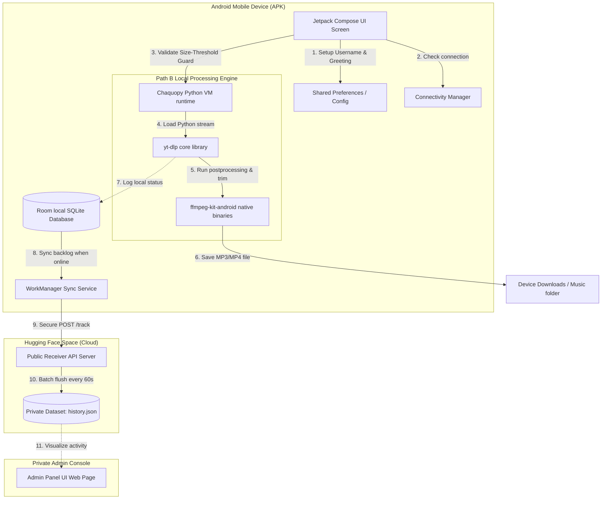
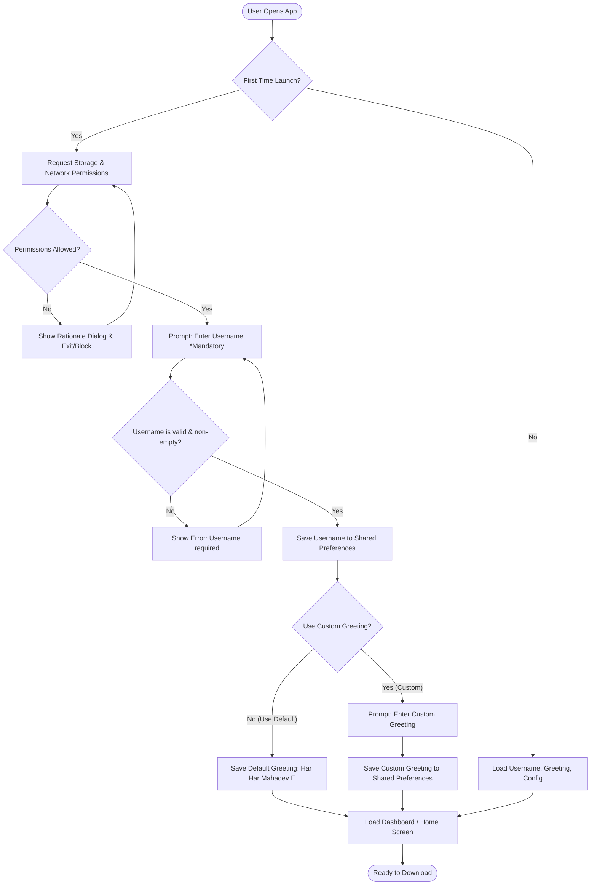

# 🔱 PINAK Android Companion App — Consolidated System Design & Technical Specification
## Comprehensive Master Blueprint for Code Generation & Native Implementation (Path B)

This document establishes the architecture, native Android tech stack, security policies, offline data syncing, and user onboarding specifications for the **PINAK Android App**. It serves as a unified master guide designed to enable any AI code generation engine or software engineer to implement the app from scratch.

---

## 📋 Table of Contents
1. [System Overview & Flowcharts](#-system-overview--flowcharts)
2. [Onboarding & Preferences Initialization](#-onboarding--preferences-initialization)
3. [Drawbacks, Solutions, and Trade-off Matrix](#-drawbacks-solutions-and-trade-off-matrix)
4. [Programmatic Guards & Validation Logic](#-programmatic-guards--validation-logic)
   * [A. Offline Connection Guard](#a-offline-connection-guard)
   * [B. 76 MB Size-Threshold Guard](#b-76-mb-size-threshold-guard)
5. [Local Execution Engine (Path B)](#-local-execution-engine-path-b)
6. [Secure Telemetry & NDK Token Hiding](#-secure-telemetry--ndk-token-hiding)
7. [Database Parity & WorkManager Sync Strategy](#-database-parity--workmanager-sync-strategy)
8. [UI/UX Themes & Navigation System](#-uiux-themes--navigation-system)
9. [Error Recovery & Implementation Roadmap](#-error-recovery--implementation-roadmap)

---

## 📡 System Overview & Flowcharts

The PINAK Android App runs as a native client executing media extraction directly on the phone (Path B) and utilizing a public server gateway to queue analytics data to a private repository.

### System Flow Diagram


---

## 📱 Onboarding & Preferences Initialization

To maintain a secure and identified state without complex setups, the app executes a linear onboarding flow on its first launch.



### A. Permission Specifications
1.  **Internet Access (`android.permission.INTERNET`)**: Mandated for downloading video stream chunks.
2.  **Storage Access**:
    *   *API level < 33*: Requires `android.permission.WRITE_EXTERNAL_STORAGE` and `android.permission.READ_EXTERNAL_STORAGE`.
    *   *API level >= 33*: Requires `android.permission.READ_MEDIA_VIDEO` and `android.permission.READ_MEDIA_AUDIO`.

---

## 🛠️ Drawbacks, Solutions, and Trade-off Matrix

Running Python script engines locally on a mobile device presents native performance bottlenecks. Below are the design workarounds, including their trade-offs.

| Drawback | Programmatic Solution | Solution Pros | Solution Cons | Selection Recommendation |
| :--- | :--- | :--- | :--- | :--- |
| **Large APK Size (80MB–120MB+)** due to Python & FFmpeg binaries. | **ABI Splitting / App Bundles (.aab)**: Generate separate APK files target-compiled for specific phone CPUs. | Reduces download size by 60%–70% (app size drops to ~30MB). | Developers must manage and sign multiple output packages. | **Highly Recommended**. Handled automatically by compilation tools. |
| **High Battery/CPU Consumption** during encoding and stream merging. | **QoS Scheduling & Progressive Streams**: Route execution to Android's energy-saving cores; request pre-merged formats directly. | Prevents device overheating; extends battery runtime. | Large stream merging/transcoding may take slightly longer to complete. | **Recommended**. Essential for device stability. |
| **Frequent App Breaks** when web platforms change encryption keys. | **OTA Engine Updates**: Dynamically fetch and load Python `.whl` files from a remote repository at startup. | Instantly fixes download pipeline without pushing APK re-installs. | Requires hosting a static file server or repository release structure. | **Highly Recommended**. Eliminates update fatigue. |
| **Slow Onboarding Startup** during first-time Python compilation. | **Lazy Engine Initialization**: Defer engine extraction until the user taps their first download action. | Zero app launch delay. User enters home screen immediately. | The loading spinner is shifted to the user's first download request. | **Recommended**. Greatly improves initial user perception. |
| **App Suspensions in Background** by Android battery optimization. | **Android Foreground Service**: Run downloads inside a service displaying a persistent progress status notification. | Downloads run uninterrupted even if the screen locks or app is closed. | The user sees a non-dismissible notification while downloading. | **Mandatory**. Keeps downloads from failing mid-process. |

---

## 📶 Programmatic Guards & Validation Logic

The application implements strict guards to block resource-heavy tasks and alert the user immediately.

### A. Offline Connection Guard
Before triggering any download command, the system monitors network connectivity. If the device is offline, it blocks the process and prints an exact required warning string.

#### Kotlin Connectivity Checker Class
```kotlin
package com.pinak.downloader.core.network

import android.content.Context
import android.net.ConnectivityManager
import android.net.NetworkCapabilities

object NetworkMonitor {
    fun isOnline(context: Context): Boolean {
        val cm = context.getSystemService(Context.CONNECTIVITY_SERVICE) as ConnectivityManager
        val activeNetwork = cm.activeNetwork ?: return false
        val capabilities = cm.getNetworkCapabilities(activeNetwork) ?: return false
        
        return capabilities.hasTransport(NetworkCapabilities.TRANSPORT_WIFI) ||
               capabilities.hasTransport(NetworkCapabilities.TRANSPORT_CELLULAR) ||
               capabilities.hasTransport(NetworkCapabilities.TRANSPORT_ETHERNET)
    }
}
```

#### Guard Implementation inside ViewModel/Presenter
```kotlin
fun onStartDownloadClicked(url: String, extractAudio: Boolean, context: Context) {
    if (!NetworkMonitor.isOnline(context)) {
        // Warning matches exact user rules for offline state
        showToast(
            context, 
            "download fail because mobile is in offline mode, plz make it online then try to download it"
        )
        recordOfflineFailure(url, extractAudio)
        return
    }
    
    // Proceed to file-size validation...
    validateContentSizeAndQueue(url, extractAudio, context)
}
```

---

### B. 76 MB Size-Threshold Guard
To protect device stability, the system enforces a strict download limit of **76 MB** ($79,691,776 \text{ bytes}$). If the media file size exceeds this value, the download is blocked, and the user is redirected to the PC/Laptop version.

#### Conceptual Python Guard Checker (`metadata_checker.py`)
```python
def check_size_under_limit(url):
    import yt_dlp
    ydl_opts = {
        'skip_download': True,
        'quiet': True,
    }
    with yt_dlp.YoutubeDL(ydl_opts) as ydl:
        try:
            info = ydl.extract_info(url, download=False)
            if 'entries' in info:
                # Playlist size aggregation
                total_size = sum(entry.get('filesize') or entry.get('filesize_approx') or 0 for entry in info['entries'])
            else:
                total_size = info.get('filesize') or info.get('filesize_approx') or 0
            
            return {"status": "success", "size_bytes": total_size, "title": info.get("title", "Media")}
        except Exception as e:
            return {"status": "error", "message": str(e)}
```

#### Kotlin Implementation Guard
```kotlin
import android.app.AlertDialog
import android.content.Context
import java.util.Locale

fun validateContentSizeAndQueue(url: String, extractAudio: Boolean, context: Context) {
    // Run the Python metadata_checker script asynchronously
    runMetadataCheckAsync(url) { result ->
        if (result.status == "success") {
            val limitBytes = 76 * 1024 * 1024 // Exact 76 MB constraint
            val sizeMb = result.sizeBytes.toDouble() / (1024 * 1024)
            
            if (result.sizeBytes > limitBytes) {
                // Display safety notice and block download
                AlertDialog.Builder(context)
                    .setTitle("⚠️ Content Size Alert")
                    .setMessage(String.format(
                        Locale.US,
                        "The size of this media is %.2f MB, which exceeds our mobile safety threshold of 76 MB.\n\n" +
                        "Downloading this directly on your device may deplete storage, drain battery, or crash your mobile OS.\n\n" +
                        "Plz use our CLI version in Laptop or PC to download this content safely.",
                        sizeMb
                    ))
                    .setPositiveButton("OK", null)
                    .show()
                
                // Record download failure state locally and push telemetry
                recordSizeFailure(url, result.sizeBytes, extractAudio)
            } else {
                // Size OK: Trigger background download worker
                enqueueDownload(url, extractAudio)
            }
        } else {
            showToast(context, "Error reading link metadata: ${result.message}")
        }
    }
}
```

---

## ⚡ Local Execution Engine (Path B)

The on-device downloader runs `yt-dlp` using **Chaquopy** and routes output files through native post-processors.

### A. Python Downloader Script (`app/src/main/python/downloader.py`)
```python
import os
import yt_dlp

def execute_download(url, output_dir, format_pref, quality_pref, extract_audio, audio_format):
    ydl_opts = {
        'outtmpl': os.path.join(output_dir, '%(title)s.%(ext)s'),
        'ignoreerrors': True,
        'quiet': True,
        'no_warnings': True,
    }

    if extract_audio:
        ydl_opts['format'] = 'bestaudio/best'
        ydl_opts['postprocessors'] = [{
            'key': 'FFmpegExtractAudio',
            'preferredcodec': audio_format,
            'preferredquality': '192',
        }]
    else:
        ydl_opts['format'] = f"bestvideo[height<={quality_pref}]+bestaudio/best/best"
        ydl_opts['merge_output_format'] = format_pref

    with yt_dlp.YoutubeDL(ydl_opts) as ydl:
        try:
            info = ydl.extract_info(url, download=True)
            files = []
            if 'entries' in info:
                for entry in info['entries']:
                    if entry: files.append(ydl.prepare_filename(entry))
            else:
                files.append(ydl.prepare_filename(info))
            
            return {
                "success": True,
                "title": info.get("title", "Media"),
                "files": files,
                "duration": int(info.get("duration", 0)),
                "size": sum(os.path.getsize(f) for f in files if os.path.exists(f))
            }
        except Exception as e:
            return {"success": False, "error": str(e)}
```

---

## 🔒 Secure Telemetry & NDK Token Hiding

Telemetry endpoints must be secured. The app compiles XOR-encrypted strings inside an NDK C++ native binary (`.so`), preventing extraction from decompiled Java bytecode.

### A. Native C++ Module (`app/src/main/cpp/native-lib.cpp`)
```cpp
#include <jni.h>
#include <string>

// Global compile key
#define XOR_SECRET 0xD9

// Encrypted proxy URL string
unsigned char encryptedUrl[] = { 0xBD, 0xAD, 0xAD, 0xB7, 0xB4, 0xFD, 0xAF, 0xAF, 0xE9, 0x9B, 0x86, 0x9D, 0x9A, 0x84, 0x96, 0x8C, 0xFD, 0x9F, 0x22, 0x9B, 0x8C, 0xFD, 0x9C, 0x97, 0x9E, 0x9C, 0x9A, 0x00 };
// Encrypted API token string
unsigned char encryptedToken[] = { 0xBD, 0xC6, 0xCE, 0xC5, 0xC3, 0xD7, 0xD3, 0xD6, 0xD4, 0xC8, 0xC7, 0xDF, 0xC4, 0xDF, 0xDF, 0xC8, 0xD9, 0xD8, 0xC7, 0xDC, 0xD7, 0xDC, 0xDF, 0xD3, 0xD6, 0xDE, 0xDF, 0xDE, 0xCD, 0xDE, 0xC6, 0xDF, 0xDC, 0xDE, 0xDF, 0xC4, 0xDF, 0xCD, 0xC8, 0xDE, 0xDF, 0xDF, 0xD6, 0xDF, 0xC7, 0xD8, 0xDF, 0xD8, 0xC2, 0xD6, 0xD9, 0xDE, 0xC4, 0xD3, 0xDF, 0xDE, 0xC2, 0xDF, 0xC6, 0xD6, 0xDF, 0xDF, 0xC8, 0x00 };

std::string decryptString(unsigned char* data, int size) {
    std::string out = "";
    for(int i = 0; i < size; i++) {
        if(data[i] == 0x00) break;
        out += (char)(data[i] ^ XOR_SECRET);
    }
    return out;
}

extern "C" JNIEXPORT jstring JNICALL
Java_com_pinak_downloader_core_security_SecurityUtils_getProxyUrl(JNIEnv* env, jobject /* this */) {
    return env->NewStringUTF(decryptString(encryptedUrl, sizeof(encryptedUrl)).c_str());
}

extern "C" JNIEXPORT jstring JNICALL
Java_com_pinak_downloader_core_security_SecurityUtils_getApiToken(JNIEnv* env, jobject /* this */) {
    return env->NewStringUTF(decryptString(encryptedToken, sizeof(encryptedToken)).c_str());
}
```

---

## 🗄️ Database Parity & WorkManager Sync Strategy

The SQLite database structure inside the APK mirrors the CLI's SQLite log structure, maintaining local history.

### A. Room Entity (`app/src/main/java/com/pinak/downloader/data/db/DownloadHistoryEntity.kt`)
```kotlin
package com.pinak.downloader.data.db

import androidx.room.Entity
import androidx.room.PrimaryKey

@Entity(tableName = "downloads")
data class DownloadHistoryEntity(
    @PrimaryKey(autoGenerate = true) val id: Int = 0,
    val time: Double = System.currentTimeMillis() / 1000.0,
    val url: String,
    val status: String,    // "success", "failed", "canceled", "rejected_size"
    val mode: String,      // "media" or "audio"
    val quality: String,
    val files: String,     // JSON string list of saved files
    val duration: Int,     // duration in seconds
    val size: Long,        // size in bytes
    val isSynced: Boolean = false
)
```

### B. Telemetry Event Synchronization Worker
Unsynced local events are compiled and pushed via `WorkManager` background tasks to `POST /track` once the network becomes active.

```kotlin
package com.pinak.downloader.core.sync

import android.content.Context
import androidx.work.CoroutineWorker
import androidx.work.WorkerParameters
import com.pinak.downloader.data.db.DownloadDatabase
import com.pinak.downloader.core.security.SecurityUtils
import okhttp3.MediaType.Companion.toMediaType
import okhttp3.OkHttpClient
import okhttp3.Request
import okhttp3.RequestBody.Companion.toRequestBody
import org.json.JSONObject

class TelemetrySyncWorker(
    context: Context,
    params: WorkerParameters
) : CoroutineWorker(context, params) {

    override suspend fun doWork(): Result {
        val database = DownloadDatabase.getInstance(applicationContext)
        val unsyncedRows = database.downloadDao().getUnsyncedRecords()
        
        if (unsyncedRows.isEmpty()) return Result.success()

        val token = SecurityUtils.getApiToken()
        val gatewayUrl = SecurityUtils.getProxyUrl()
        val client = OkHttpClient()

        for (row in unsyncedRows) {
            val json = JSONObject().apply {
                put("activity_type", "download")
                put("username", getSavedUsername())
                put("device_id", getDeviceUUID())
                put("url", row.url)
                put("status", row.status)
                put("mode", row.mode)
                put("quality", row.quality)
                put("duration", row.duration)
                put("size", row.size)
                put("platform", extractPlatformName(row.url))
            }

            val body = json.toString().toRequestBody("application/json".toMediaType())
            val request = Request.Builder()
                .url("$gatewayUrl/track")
                .post(body)
                .addHeader("Authorization", "Bearer $token")
                .build()

            try {
                val response = client.newCall(request).execute()
                if (response.isSuccessful) {
                    database.downloadDao().markSynced(row.id)
                }
            } catch (e: Exception) {
                return Result.retry() // Reschedule on network failures
            }
        }
        return Result.success()
    }
}
```

---

## 🎨 UI/UX Themes & Navigation System

The app's style mirrors the high-contrast dark theme elements of the PINAK command-line interface.

### Color Palette Specification
*   **Primary Background**: `#0D0E15` (Slate Black Canvas)
*   **Surfaces/Card Blocks**: `#161925` (Dark Navy Panels)
*   **Accent Color**: `#00E5FF` (Neon Cyan)
*   **Icon/Logo Accent**: `#FF6D00` (Vibrant Orange representing Pinak's trident)

### Primary View Sections (Bottom Navigation)
1.  **Dashboard (Home)**: Shows aggregate download totals, averages, active jobs, and status charts.
2.  **Downloader**: Houses the URL text input box, format switches (MP3/MP4), quality selectors, and download actions.
3.  **History Log**: Shows a chronological list of downloads. Tap on successful files to play them immediately using native media controls.
4.  **Settings**: Configures system configurations: Username settings, Greeting string formats, directory targets, and sorting actions.

---

## 🛡️ Error Recovery Matrix

| Scenario Case | Failure Detection | Recovery Strategy |
| :--- | :--- | :--- |
| **Invalid Target Link** | Python module throws extraction exceptions | Save status as `failed` inside Room. Toast user: *"Platform not recognized or media unavailable"*. |
| **User Stops Download** | User presses 'Cancel' or clears app task | Interrupted threads cancel the active Python execution. Terminate FFmpeg instances, wipe cache files, and write status as `canceled`. |
| **Low Disk Space** | OSError: No storage space left | Stop download loop. Alert user: *"Disk space full. Clear space and retry."* |
| **Telemetry Server Down** | HTTP status codes 5xx / Connection Timeout | Cache log transaction. Write row to Room DB as `isSynced = false`. WorkManager uploads the logs during its next scheduled cycle. |

---

## 🚀 Step-by-Step Code Generation Roadmap

AI systems can implement this specification following these steps:

*   **Step 1: UI Onboarding Setup**  
    Write Compose interfaces capturing: storage/media permission checks, username validator dialogs, and greeting text selectors.
*   **Step 2: Database Layer**  
    Compile the Room DB framework. Write database access objects, schemas, queries, and migrations.
*   **Step 3: Chaquopy & NDK integration**  
    Edit `build.gradle` structures. Set target ABI CPU filters. Load XOR native string decryption keys into a C++ helper package.
*   **Step 4: Offline Guards & Size Threshold Validator**  
    Code network connectivity triggers and size-threshold gates (blocking sizes > 76 MB and warning the user to use the CLI version).
*   **Step 5: Process Workers**  
    Bind foreground execution wrappers, status notification hooks, process termination signals, and SQLite sync workers.
