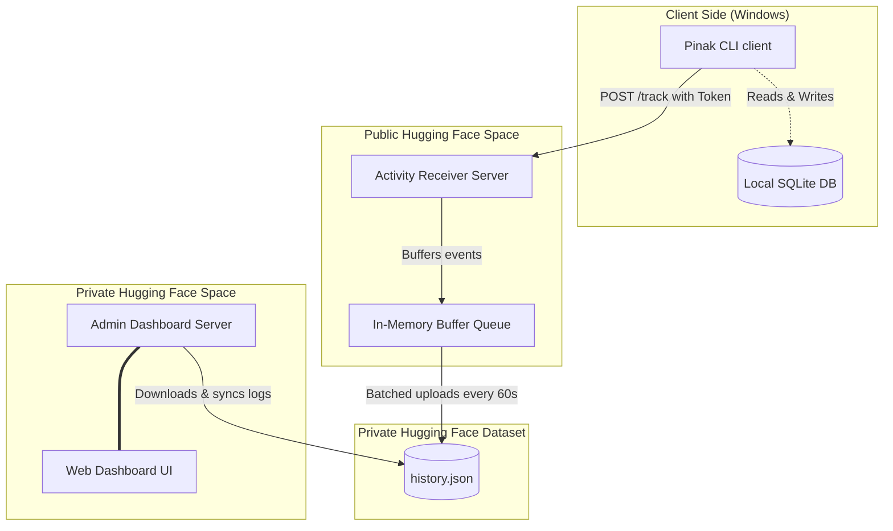

# 🔱 PINAK Ecosystem — Advanced Media Downloader & Tracker

Welcome to the **PINAK** ecosystem, a modern, high-performance, and beautifully designed end-to-end media downloader and tracking suite. 

The ecosystem is composed of a rich CLI client and two custom-built FastAPI web servers optimized for serverless deployment on **Hugging Face Spaces**.

---

## 📊 System Architecture

The PINAK system uses a secure, stateless, and low-overhead tracking architecture that guarantees no direct client exposure to sensitive database tokens or credentials:



---

## 🗂️ Directory Structure

The repository is modularly structured to separate client code from server deployments:

```text
D:\pinak/
├── cli/                        # 🔱 CLI Client Package (Python)
│   ├── pinak/                  # Package source folder (cli, downloader, utils, config)
│   ├── extra/                  # Unnecessary / legacy resources & tools
│   │   ├── .pinak_history.json.bak
│   │   ├── PINAK_CLI_EXCELLENCE_GUIDE.md
│   │   ├── instagram.py
│   │   └── supabase_setup.sql
│   ├── downloads/              # Default downloads folder (excluded)
│   ├── pyproject.toml          # Package installation config (setuptools entry point)
│   ├── pinak_cli.py            # Local wrapper startup script
│   ├── ffmpeg.exe              # Packaged FFmpeg binary for Windows
│   ├── ffprobe.exe             # Packaged FFprobe binary for Windows
│   └── README.md               # CLI-specific documentation
│
├── server/                     # 📡 Public Receiver Server (FastAPI)
│   ├── app.py                  # Receiver application with buffering & rate limiting
│   ├── Dockerfile              # Docker recipe for Hugging Face deployment
│   ├── requirements.txt        # Server dependencies
│   └── README.md               # Receiver-specific documentation
│
├── admin_server/               # 🖥️ Private Admin Dashboard Server (FastAPI)
│   ├── app.py                  # Dashboard application with rich CSS interface
│   ├── Dockerfile              # Docker recipe for Hugging Face deployment
│   ├── requirements.txt        # Server dependencies
│   └── README.md               # Admin-specific documentation
│
├── ANDROID_APP_DESIGN.md       # 📱 Android Application Design & Implementation Document
└── README.md                   # 📖 Master System Documentation (This File)
```

---

## ⚙️ Component Breakdown

### 1. Pinak CLI (`cli/`)
A fully-featured Windows command-line REPL designed with `rich` and `prompt-toolkit`.
*   **Media Downloader**: Wraps `yt-dlp` and `ffmpeg` to download high-resolution video or extract audio streams (MP3) from hundreds of sites (YouTube, Instagram, JioSaavn, etc.).
*   **Interactive Shell**: Prompts with auto-suggestions, command completions, and execution history.
*   **System Diagnostics**: Runs diagnostic tests (`pinak --doctor`) to check network status, local binaries, configuration, and API latency.
*   **Local Persistence**: Writes a local SQLite history log (`history.db`) so the user can easily view previous downloads offline.
*   **Telemetry Client**: Dispatches download events and session stats to the public receiver.

### 2. Pinak Receiver Server (`server/`)
A public-facing FastAPI server that accepts client tracking telemetry securely.
*   **Stateless Buffering**: Holds incoming events in an in-memory queue to prevent hitting the Hugging Face API rate limits on every transaction.
*   **Cron Auto-Flush**: A background task automatically merges, flushes, and commits the memory queue to a private Hugging Face Dataset (`history.json`) every 60 seconds.
*   **Client Security**: Uses a lightweight Bearer token (`PINAK_API_TOKEN`) to authenticate incoming telemetry requests. The client never handles the sensitive read/write `HF_TOKEN`.
*   **Robust Resiliency**: If Hugging Face is temporarily down, the receiver dumps pending items to a local file (`pending_events.json`) and retries the upload on the next flush.

### 3. Pinak Admin Server (`admin_server/`)
A private, Dockerized FastAPI server rendering a beautiful, modern web dashboard.
*   **Aesthetic UI**: Custom CSS stylesheet featuring a premium dark mode, layout animations, glassmorphism filters, status indicators, and collapsible JSON payloads.
*   **Real-time Activity Stream**: Visualizes all sessions, CLI commands, and downloads in a chronological timeline.
*   **Management Controls**: Allows administrators to search/filter records, delete single logs, completely wipe the history with double-confirmation prompts, and download the full history file as a backup.
*   **Automatic Auth**: Relies on Hugging Face's built-in private Space authorization (only users logged into the owner's HF account can view the dashboard).

### 4. Pinak Android App (Design in [ANDROID_APP_DESIGN.md](file:///D:/pinak/ANDROID_APP_DESIGN.md))
A native mobile companion application designed for Android devices.
*   **Mobile Downloader**: Utilizes a JNI wrapper for `yt-dlp` to fetch media directly to the device.
*   **Share Target integration**: Captures media links directly from the native Android share menu.
*   **Offline Support**: Employs Room database persistence and a sync engine to queue, track, and upload download history when online, including network guards.

---

## 🚀 Quick Setup & Installation

### A. Deploying the Servers on Hugging Face

You can deploy the receiver and admin dashboard servers to **Hugging Face Spaces** using the provided Dockerfiles:

1.  **Create a Public Space** for the Receiver:
    *   Name it (e.g. `pinak-receiver`).
    *   Set the SDK to **Docker** (choose the blank template).
    *   Configure the following **Variables and Secrets**:
        *   `PINAK_API_TOKEN`: A secret password token shared with the CLI.
        *   `HF_TOKEN`: Hugging Face Write-enabled Access Token.
        *   `HF_DATASET_ID`: Path to a private HF dataset (e.g. `your-username/pinak-history`).
2.  **Create a Private Space** for the Admin Dashboard:
    *   Name it (e.g. `pinak-admin`).
    *   Set the SDK to **Docker** (choose the blank template) and make it **Private**.
    *   Configure the following **Variables and Secrets**:
        *   `HF_TOKEN`: Hugging Face Write-enabled Access Token.
        *   `HF_DATASET_ID`: The same private dataset used by the receiver (e.g. `your-username/pinak-history`).
3.  **Push the Code**:
    *   Initialize git repositories in the respective folders (`server/` and `admin_server/`) and push them to their Hugging Face Space remotes.

---

### B. Installing the CLI Client

1.  Open your terminal at `D:\pinak\cli` and install the package globally in editable mode:
    ```bash
    pip install -e .
    ```
2.  Set the environment variables on your system to connect the CLI to your public receiver:
    *   **PowerShell**:
        ```powershell
        [Environment]::SetEnvironmentVariable("PINAK_PROXY_URL", "https://your-username-pinak-receiver.hf.space", "User")
        [Environment]::SetEnvironmentVariable("PINAK_API_TOKEN", "your-shared-api-token", "User")
        ```
    *   **CMD**:
        ```cmd
        setx PINAK_PROXY_URL "https://your-username-pinak-receiver.hf.space"
        setx PINAK_API_TOKEN "your-shared-api-token"
        ```
3.  Run the CLI from any directory in your terminal:
    ```bash
    pinak
    ```

---

## 🔒 Security & Privacy Model

*   **Zero Credential Exposure**: Clients only receive the proxy endpoint URL and the low-privilege `PINAK_API_TOKEN`. The master Hugging Face token (`HF_TOKEN`) remains strictly server-side.
*   **Privacy-First Admin Space**: The admin panel uses Hugging Face's built-in OAuth gateway, blocking all unauthorized traffic automatically before it even reaches the FastAPI app.
*   **Fail-Soft Client**: If the receiver is offline, the CLI suppresses errors and proceeds with downloads offline. Telemetry is non-blocking and will never interrupt the user experience.
