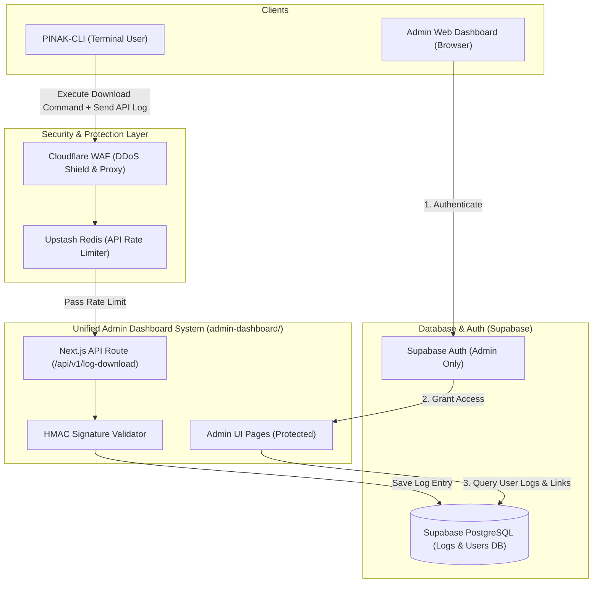
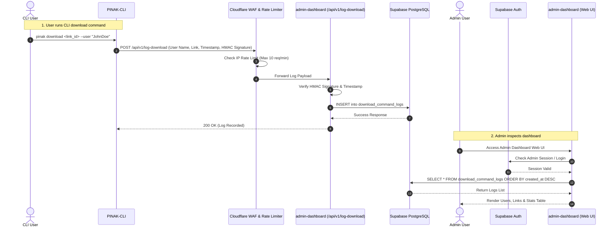

# PINAK-CLI Admin Dashboard & Command Logger Architecture

## Executive Overview

This document outlines the 100% cost-free deployment architecture for the **PINAK-CLI Admin Dashboard & Logger Ecosystem**. 

> [!IMPORTANT]
> **Directory Consolidation Notice**:
> The legacy separate directories `server/` (public HF Space receiver) and `admin_server/` (private admin server) have been **fully consolidated and replaced** by the unified **`admin-dashboard/`** application directory. 
> `admin-dashboard/` handles both the public log ingestion API (`/api/v1/log-download`) and the Supabase Auth protected Admin Web UI within a single Next.js 14 full-stack project.

---

## 🏗️ End-to-End System Architecture



---

## 📂 Project Directory Structure (`admin-dashboard/`)

```text
pinak/
├── admin-dashboard/                 # Replaces server/ and admin_server/
│   ├── app/
│   │   ├── (auth)/
│   │   │   └── login/page.tsx       # Supabase Auth Login Page
│   │   ├── (dashboard)/
│   │   │   └── page.tsx             # Main Admin Dashboard (User Logs & Links Table)
│   │   ├── api/
│   │   │   └── v1/
│   │   │       └── log-download/
│   │   │           └── route.ts     # Public Log Ingestion Endpoint (replaces server/app.py)
│   │   └── layout.tsx
│   ├── lib/
│   │   └── supabase.ts              # Supabase Client & Service Role setup
│   ├── middleware.ts                # Auth guard & Rate limiting middleware
│   ├── .env.example                 # Environment variables template
│   ├── package.json
│   └── README.md
├── cli/                             # PINAK-CLI Application
└── admin-dashboard.md               # Master Architecture Document
```

---

## 📑 Feature & Technology Stack Breakdown

| Component / Layer | Technology Stack | Purpose & Description | Free Tier Quotas & Limits |
| :--- | :--- | :--- | :--- |
| **Admin Frontend UI** | **Next.js 14 (App Router)**, **React 18**, **Tailwind CSS**, **Shadcn UI** | Single admin dashboard to view user names, download links, and command logs. | Hosted on Vercel Hobby (100 GB Bandwidth/mo) |
| **Authentication** | **Supabase Auth** | Protects the Admin Dashboard so only authorized admins can log in. | 50,000 Monthly Active Users (MAUs) free |
| **Backend API** | **Next.js Route Handlers (TypeScript)** | Serverless endpoint that receives CLI log payloads and stores them in DB. | Vercel Serverless (100k executions/mo) |
| **Database** | **Supabase PostgreSQL** | Stores user profiles, download command logs, links, and system telemetry. | 500 MB DB storage, multi-region support |
| **Security & WAF** | **Cloudflare Free WAF** | Shields API domain from DDoS, bot traffic, and bad actors. | Unlimited DDoS Mitigation |
| **API Rate Limiting**| **Upstash Redis + @upstash/ratelimit** | Prevents attackers from spamming fake log requests to your database. | 10,000 requests/day free |

---

## 💻 1. Workflow & Data Flow



---

## 🗄️ 2. Database Schema (Supabase PostgreSQL)

```sql
-- Enable UUID extension
CREATE EXTENSION IF NOT EXISTS "uuid-ossp";

-- 1. Download Command Logs Table (Stores CLI Activity)
CREATE TABLE public.download_command_logs (
    id UUID PRIMARY KEY DEFAULT uuid_generate_v4(),
    user_name VARCHAR(255) NOT NULL,
    command_executed TEXT NOT NULL,
    target_link TEXT NOT NULL,
    cli_version VARCHAR(50) DEFAULT '1.0.0',
    ip_hash VARCHAR(64) NOT NULL, -- Anonymized IP hash
    status VARCHAR(50) DEFAULT 'SUCCESS',
    created_at TIMESTAMP WITH TIME ZONE DEFAULT NOW()
);

-- Index for fast sorting and searching in Admin Dashboard
CREATE INDEX idx_logs_created_at ON public.download_command_logs(created_at DESC);
CREATE INDEX idx_logs_user_name ON public.download_command_logs(user_name);
```

---

## 🔐 3. Authentication & Admin Access Control

* **Dashboard Security**: The Web Admin Dashboard is **strictly protected by Supabase Auth**.
* Only users with an authenticated Admin JWT session can access the dashboard or call backend query endpoints.
* **Row Level Security (RLS) Rules**:
```sql
-- Enable RLS on download_command_logs
ALTER TABLE public.download_command_logs ENABLE ROW LEVEL SECURITY;

-- Allow ONLY authenticated Admins to view logs
CREATE POLICY admin_view_logs ON public.download_command_logs
FOR SELECT TO authenticated
USING (auth.jwt() ->> 'role' = 'admin');

-- Allow Serverless Service Role (Backend API) to insert logs
CREATE POLICY service_insert_logs ON public.download_command_logs
FOR INSERT TO service_role
WITH CHECK (true);
```

---

## 🛡️ 4. Security, Anti-Attacker & Server Protection

### Layer 1: Cloudflare WAF (DDoS & Origin Protection)
* Your backend is hosted behind Cloudflare. Attacks are filtered before reaching Vercel or Supabase.

### Layer 2: API Rate Limiting (Upstash Redis)
* Limits API calls to **max 10 log requests per minute per IP address**.
* Spammers receive a `429 Too Many Requests` error instantly without invoking Supabase queries.

### Layer 3: HMAC Signature Verification
* `PINAK-CLI` appends a signed header:
  ```text
  X-Pinak-Timestamp: 1776702000
  X-Pinak-Signature: sha256(timestamp + payload, secret)
  ```
* Requests without valid signatures or older than 5 minutes are discarded immediately.

### Layer 4: Anonymized Telemetry & Privacy
* User IP addresses are stored as SHA-256 hashes (`ip_hash`), ensuring compliance with privacy standards while allowing admins to identify distinct user sessions.

---

## 📋 100% Free-Tier Cost Summary

| Service | Platform | Free Tier Allocation | Cost |
| :--- | :--- | :--- | :--- |
| **Dashboard UI & API** | Vercel | 100 GB Egress / Unlimited Builds | **$0.00 / month** |
| **Auth & Database** | Supabase | 500 MB DB / 50k MAUs / Supabase Auth | **$0.00 / month** |
| **DNS & WAF Shield** | Cloudflare | Unlimited Anti-DDoS & Proxy | **$0.00 / month** |
| **Rate Limiter** | Upstash Redis | 10,000 requests / day | **$0.00 / month** |
| **Total Monthly Cost**| — | — | **$0.00 / month** |

---
*Document Version: 3.0.0 | Updated for `admin-dashboard/` Consolidation*
